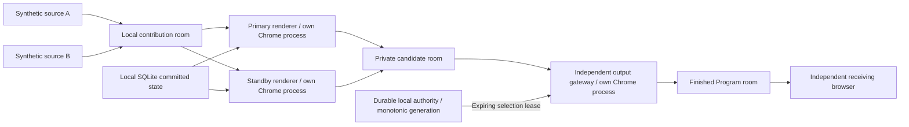

# Phase 7 — local fenced failover lab

The local portion of Phase 7 now exercises two candidate renderers, an independent output gateway and a separate receiving browser. No Vercel build/deployment, AWS resources, production API/database/Zoom calls or meeting joins are used. No Program media is recorded or stored.

This is a **single-Mac resilience prototype**, not commercial high availability. It cannot survive loss of this Mac, its SFU or its single control authority. Gateway recovery is an explicit bounded local drill, not a redundant gateway service. Do not call the result seamless failover or a multi-AZ deployment.

## Media and authority flow



Candidates receive separate capabilities and signed SFU grants. Their output tokens publish only to the candidate room; input tokens only subscribe to contributions. They cannot request gateway credentials or publish into Program. Only the gateway receives a Program publisher grant. The receiver subscribes to Program only.

The gateway keeps both candidate inputs warm. A one-second selection lease specifies the exact candidate identity, committed revision, run ID and fencing generation. The gateway rejects earlier generations, revision regressions, another candidate at the same generation, a foreign run and delayed grants. The local diagnostic wire format is 24 bits; generations fail closed at that limit rather than wrapping. Expiry uses its monotonic request-start clock so a slow HTTP reply cannot extend permission. If authority is unavailable or the selected input is stale/not at the committed revision, it renders a labelled slate and mutes the candidate audio.

A durable journal records selection boundaries before a promotion is acknowledged. A journal write failure withdraws authority. Reload advances the persisted generation, retains the selection and requires fresh readiness. This is a journal/object reload test, not a redundant database/control-plane failover.

## Synchronization and takeover

Both renderers reuse the existing local compositor and consume the same committed SQLite snapshot, source bindings, local fixture assets, audio intent and playback anchors. The drill checks the same committed revision and a paused video fixture at 900 ms. Cross-host asset distribution, moving-playback drift and clock synchronization are not established by this test.

A heartbeat is insufficient. The authority also requires outgoing encoded-frame progress, no candidate error and the latest committed revision before granting selection. It does not promote merely because the active renderer is briefly applying a new command. If active output progress becomes unavailable, it can promote a ready standby after the freshness window. If no candidate is ready or authority is unavailable, it cannot promote.

The simulated partition blocks one renderer's control reads and reports with local HTTP failures **while keeping its browser, candidate publication and WebRTC media alive**. It is an application fault injection, not OS packet shaping or a physical network partition. During the stronger drill, that old primary retains source A/440 Hz, while standby applies source B/660 Hz. The independent receiver verifies the new picture, approximate dominant tone and candidate-owned visual marker. The gateway's own selection marker must match the candidate-owned marker; it is not accepted as proof by itself. Continued private-frame progress proves the old primary was not simply killed.

Candidate takeovers retain the gateway's Program video/audio track SIDs. Gateway replacement must first confirm the old owned process/publication is gone, advance the output epoch/generation and use a new publication. The receiver reacquires it and records a discontinuity rather than claiming a continuous track.

## Run locally

With Node 24, the checked native Chrome and LiveKit versions installed:

```sh
npm run production:ha
# Open http://127.0.0.1:4311/
# In a second terminal:
npm run production:ha:verify
```

The server binds only `127.0.0.1:4311`, with a separate SFU on loopback TCP 7980/UDP 7982, no STUN/external candidates and no wildcard media listener. Worker capabilities and SFU signing secrets are generated locally. Secret SFU configuration is private and removed at stop. No `.env` file is loaded. Browser HTTP requests are limited to loopback; the lab serves an explicit fixture/runtime allowlist.

Each candidate, gateway, source and observer has its own owned Chrome process. The lab stops media after ten minutes. The verification plan is bounded to four minutes and always stops owned media workers/SFU on completion or failure, leaving the report page available. Native recovery budgets permit one primary restart, one gateway replacement and two injected candidate partitions per run. Runtime and verification locks prevent accidental concurrent runs. If an interrupted command leaves a lock, inspect its owner before removing it; do not discard journals or reset generations to make a test pass.

The UI can inject local faults while a lab is running. Its reports are labelled historical after stop and its action buttons are disabled. Rerunning a stopped lab requires intentionally restarting the local host; it does not silently start another test.

## Evidence and interpretation

Ignored local files under `.local/production/ha/` contain:

- `verification.json`: checks, receiver observations, timestamps, outcome and cleanup.
- Timestamped earlier verification files, preserving failed/incomplete attempts.
- `authority.json`: persisted generation and output selection boundaries.
- `samples.json`: bounded gateway/receiver metadata history.
- `status.json`, `events.ndjson`, `control.sqlite` and local SFU diagnostics.

No files contain program frames, recordings, process memory or printed connection secrets. The motion asset used by the existing compositor is generated temporarily in browser memory as a synthetic fixture; it is not a recording of the outgoing Program.

Receiver reports decode unique picture/revision/selection markers, track publication identity/SIDs, sample audio RMS and estimate the synthetic tone frequency. Video interruption is the interval between valid decoded pictures; audio interruption is estimated between audible RMS samples (100 ms sampling). Slate durations and maximum gaps include all drill activity, including deliberate authority loss and asset preparation. These are not sample-accurate audio edit boundaries or an A/V lip-sync measurement.

Generation boundaries are a **metadata discontinuity journal**, not proof of uninterrupted file recording. Real recording segment/gap manifests and playback continuity remain a separate opt-in test. No recorder is started here.

## Before calling this commercial HA

The remaining gates require explicit authorization for an environment beyond this Mac:

1. Place primary and standby on separate hosts/AZs and demonstrate synchronized state, assets and moving playback timelines.
2. Test actual network partitions and coordinator loss, including receiver-visible frame/audio gaps and clock behavior.
3. Make gateway, SFU, durable control/state and supervision independently recoverable. A browser lease alone does not protect against a compromised/frozen gateway or a failed host.
4. Prove old gateway fencing at an independent downstream data plane before allowing redundant gateways. This lab issues one gateway's credentials and replaces it only after stopping the old process/publication.
5. Measure real recording discontinuities, long event-length stability, failover objectives, audience reconnects and intended audience scale on the built deployment image.

The existing image recipe is still unbuilt and no cloud cutover is performed. Local crash/partition tests establish only the specific tested single-host behavior.

## Measured local result — 27 October 2026

The final content-verified run completed all **nine acceptance checks** in 25.07 seconds, then stopped every owned media worker and the separate test SFU. No Program recorder ran.

- Both renderers applied the same asset/state revision and paused video position.
- During the control partition, old primary private-frame progress continued from 259 to 325 while the receiver stayed on standby. The old primary retained the previous revision. The received new scene was source B, with candidate-owned standby provenance and a dominant tone around 656.25 Hz.
- The first observed standby recovery report arrived about 4.171 seconds after partition injection. This includes the deliberate committed-scene change while the primary was isolated; it is not a zero-gap output claim.
- Stale-generation promotion was rejected. Candidate takeovers retained the gateway's Program track SIDs.
- A primary crash, authority-link outage, gateway replacement and journal reload all recovered under their tested conditions. The gateway replacement changed Program track SIDs and publication epoch explicitly.
- No candidate-selection/provenance mismatch or decoded generation regression was observed. Only one Program publisher remained.
- Maximum valid-picture interval across the drill: **4.084 seconds**. Maximum interval between audible samples: **3.906 seconds**, with 100 ms sampling. Maximum observed slate interval: **3.122 seconds**. These include intentional interruptions and asset preparation. They do not establish a production recovery SLA.

Receiver resolution adapted during startup/reconnection; the observed dimensions were 320 × 180, 480 × 270, 640 × 360. This short drill establishes fencing/recovery behavior, not sustained HD/FPS performance. Full-quality long-duration HA remains a separate gate.

Earlier attempts remain archived. Two strengthened attempts failed an overly strict RGB color-probe threshold despite correct standby provenance, revision and audio tone. The final classifier uses measured post-codec samples and rejects slates/ambiguous colors; its regression tests pass. Those earlier attempts were not relabelled successful.

Final automated verification: **290 tests passed**, with TypeScript checking, targeted lint and checked native-runtime preflight. Source packaging stays in the ignored local artifact directory; no push or deployment.

## Full HD and fast-failover follow-up

A later local run qualified three 1080p windows at approximately 30 fps and reduced measured fault-specific picture gaps to 92–461 ms. See [local Full HD / fast failover](local-fullhd-fast-failover.md) for changes, acceptance thresholds, preserved failed attempts and remaining limits. The earlier figures above remain the historical Phase 7 baseline.


## Local producer-room rehearsal integration

The standalone local producer room is available at `http://127.0.0.1:4311/producer` using `npm run production:producer:local`. It uses the qualified primary/standby compositor pipeline and explicit-frame Program gateway, rather than the older single-renderer workbench. It starts off air with demo sources and a thirty-minute media limit. No production Next.js routes, Supabase, AWS resources or Vercel deployment are used.

The same revision-checked durable command service drives Preview composition, cut/fade TAKE, text/logo overlays, split/PIP layouts, Program gain/mute and locally saved scenes. Program monitoring subscribes only to the finished Program; Preview subscribes read-only to the input room and never publishes. The gateway remains the sole Program publisher. Monitor mute is separate from Program mute.

Inputs A/B can be explicitly replaced with a camera, screen share or an existing MP4/WebM. Browser permission/chooser actions are operator initiated. Physical-device capture is never started by the host. Input audio is opt-in. Files are read through browser object URLs and paced into a local source track; they are not uploaded, copied into the asset library or saved in show state. File pause/resume, rewind and loop are available locally. The file decoder and physical device permissions still require attended verification on the operator's browser.

Input publishers hold private ten-second renewable ownership leases and can publish only into the private input room under their fixed source identity. The server verifies the track exists for that identity before binding it. Input replacement first retires the demo publisher. Lease loss, Stop, native capture end, page closure and session expiry stop/revoke the input; stale/missing inputs report fallback. Capture selection has a sixty-second timeout and can be cancelled. Lease credentials and blob URLs are never written into durable scenes.

Recording controls/endpoints are absent. The rehearsal command adapter rejects infrastructure/binding commands, nonqualified transitions and recording-producing fixture assets; the HA scene-fixture shortcut is also disabled in rehearsal. This preserves the strict no-recording scope, including synthetic clip generation. No `MediaRecorder` is used by the producer UI/input path.

A separate birth-checked watchdog arms before starting media, with the rehearsal's nonextendable thirty-minute deadline. Its monotonic bound honors that deadline even if the wall clock moves backward. It stops only exact owned processes on owner loss/deadline. The normal UI Stop still leaves a read-only review host once media cleanup is complete. Pending native capture requests are cancelled locally, and late-resolving tracks are immediately stopped.

### Attended run sheet

The expandable run sheet inside the room covers: demo Preview/TAKE/live; camera A and display B; source resolution/audio checks; Preview isolation; cuts/fades/layouts/title/logo; Program vs monitor mute; file playback controls; save/load scenes and stale-console conflict; native share Stop/reconnect; controlled stall/crash/takeover; and final Stop with browser capture indicators cleared. Use headphones for audio monitoring. Diagnostic marker strips remain visible for this rehearsal.

`npm run production:producer:verify` exercises the command/API/state/received-media flow with an explicitly in-memory camera/audio stub, never a physical device. Native fake-device requests did not resolve in this pinned Chrome test setup; those failed attempts remain archived and are not reported as native-device passes. Native camera/display chooser behavior, real file codecs and perceived lip sync remain attended checks. Verification metadata is retained under `.local/production/ha/producer-rehearsal/verification.json`; failed earlier attempts are timestamped. The automated check forbids `MediaRecorder` and checks source binding/fallback, saved scenes, audio mute/unmute, measured full-HD delivery and crash/stall publication continuity. It is a short integration check, not a new hour-long hardware-input soak.


Final integration verification completed with 8 checks. The in-memory capture stub delivered native 1920×1080; the 20.099-second received-Program window measured 30.0015 distinct, decoded and presented fps, with one-second p05 29.7915. Active-primary stall and process-crash gaps were 483 ms and 68 ms, preserving the Program video SID. The stub capture/browser were closed, missing-input fallback and demo restoration verified, and the session left off air. 305 automated tests, type checking, targeted lint and pinned-native preflight passed. The operator handoff starts a fresh bounded session so drill restart budgets are not already consumed by verification. These results do not claim native hardware/display/file-codec or long-duration real-input validation.
